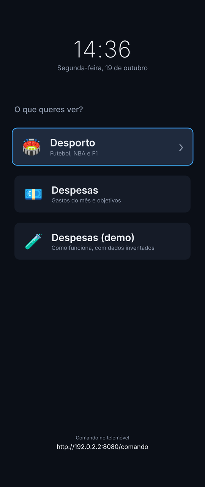
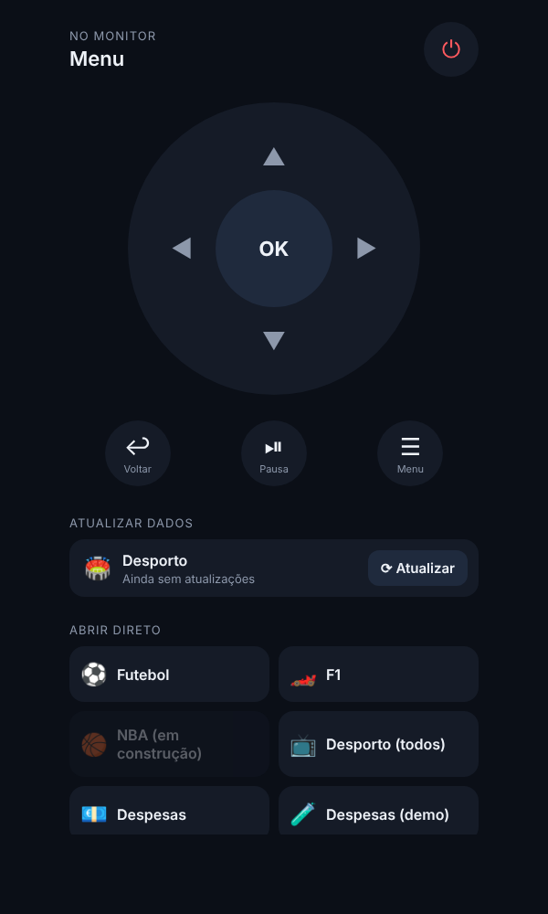
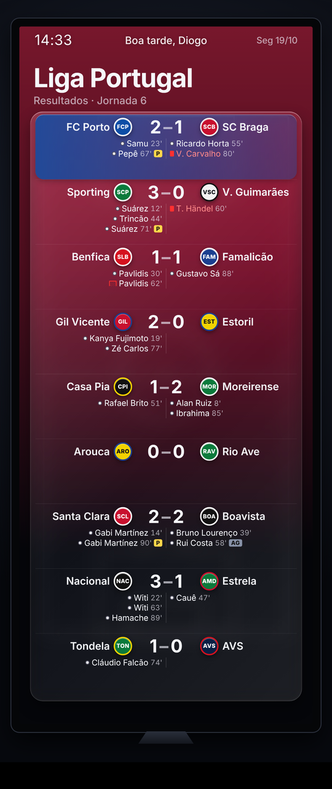

# Super Monitor

Um monitor de 34" na parede, rodado na vertical, que funciona como uma "TV" de casa:
um menu de apps (desporto, despesas do casal, e o que vier), comandado pelo telemóvel.
Cada app só corre enquanto está escolhida.

Projeto pessoal, feito em Python (só biblioteca padrão no hub e no desporto) e
HTML/CSS/JS sem frameworks.

<p align="center">
  
  
  
  
</p>

> Todas as capturas usam dados fictícios (`?mock=1` no desporto, "Despesas (demo)" no hub).

## As partes

| Pasta | O que é |
|---|---|
| [`hub/`](hub/) | **MonitorHub.** Servidor (Python, stdlib) com a lista de apps em `apps.json`. O monitor abre sempre a mesma página (menu, ecrã de carregamento, app ativa num iframe); o telemóvel abre `/comando`, uma PWA com setas, OK, voltar, pausa, menu e ⏻. Arranca e para o processo de cada app a pedido. |
| [`desporto/`](desporto/) | **Dashboard desportivo** 1080×2560: futebol (Liga Portugal, Premier League, La Liga, Bundesliga, Ligue 1, Serie A e taças europeias), Fórmula 1 e NBA, com notícias. Cenas em rotação, controladas pelo comando. Todas as fontes são públicas e sem chave de API (ESPN, Jolpica F1, OpenF1, Record RSS, Wikipédia). |
| [despesas-casal](https://github.com/LimeWolf9/despesas-casal) (repositório à parte) | **Despesas do casal.** App Streamlit + SQLite que importa extractos bancários em PDF, valida cada um pelos saldos, e categoriza por regras que aprendem com um clique. Exporta só totais (sem movimentos nem saldo) para a página do monitor (`hub/web/apps/despesas.html`). Tem modo demo com dados inventados. |

## Como as peças falam

```
 telemóvel (/comando) ──POST /api/comando──►  hub.py  ──SSE /api/eventos──►  monitor (ecrã)
                                                │                               │
                                  arranca/para o processo da app       iframe da app ativa
                                                │                               │
                                    desporto/serve.py, ...       ◄── postMessage "monitorhub:1" ──►
```

- **Protocolo comum:** o ecrã passa cada tecla do comando à app ativa por `postMessage`
  (`{monitorhub: 1, tipo: "comando", acao}`); a app responde `pronto`, `nao_tratado` ou `aviso`.
  Qualquer página que fale este protocolo pode ser uma app. Ver [`hub/PROTOCOLO.md`](hub/PROTOCOLO.md).
- **Atualizar sem abrir a app:** o hub corre o atualizador de uma app e mostra o progresso
  no comando, lendo um JSON de estado que a app escreve.
- **Código por app:** uma app pode pedir um PIN, marcado no teclado do comando e verificado
  só no servidor (5 erros = 1 minuto bloqueado).
- **Ecrã desligado:** ⏻ fecha a app e apaga o ecrã; o `config.json` tem ganchos para
  desligar o monitor a sério (ex.: Home Assistant, no futuro).

## Experimentar

Precisa de Python 3.11+.

```bash
# dashboard desportivo, com dados fictícios
cd desporto
python serve.py
# abre http://127.0.0.1:8000/?preview=1&mock=1

# hub (noutro terminal)
cd hub
python hub.py
# monitor: http://127.0.0.1:8080/   comando: http://<ip-do-pc>:8080/comando
```

Para dados reais do desporto: `python tools/atualizar_tudo.py` (ou o botão "Atualizar" no comando).
A app de despesas vive em [despesas-casal](https://github.com/LimeWolf9/despesas-casal); para o hub a encontrar, clona-a ao lado desta pasta (`../despesas-casal`).

No Windows, `hub/MonitorHub.bat` e `desporto/Dashboard.bat` abrem o Edge em ecrã inteiro
no monitor que estiver na vertical.

## O que não está no repositório

- **Dados pessoais:** nada das despesas reais, e o PIN do hub.
- **Imagens de terceiros:** emblemas dos clubes, logótipos das competições, fotos de pilotos
  e caras de jogadores são marcas ou imagens dos respetivos donos. Os atualizadores
  descarregam-nos no PC de cada um (`desporto/tools/baixar_emblemas.py`,
  `desporto/tools/atualizar_fotos.py`); sem eles o dashboard mostra um círculo com as cores e a sigla.

## Próximos passos

- Correr tudo num mini PC (Linux + Docker) ligado ao monitor, com as apps a arrancar em containers.
- Home Assistant a mandar os mesmos comandos que o telemóvel (ligar o monitor, abrir uma app).
- NBA quando começar a época; tempos ao vivo da F1.

## Licença

[MIT](LICENSE). Os dados vêm das fontes públicas indicadas acima e ficam sujeitos aos termos de cada uma.
